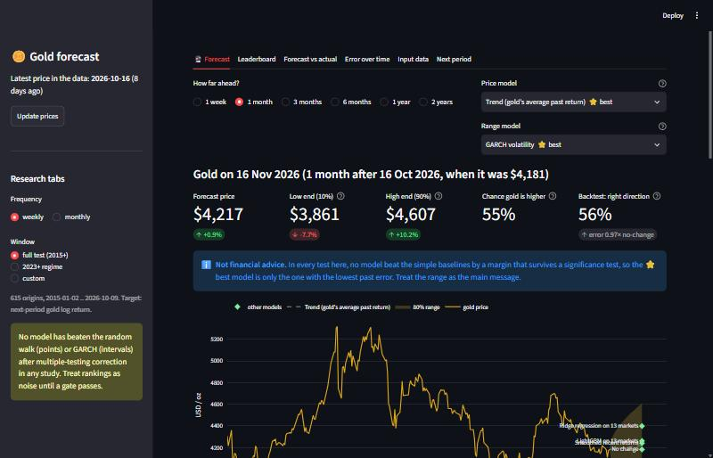

# goldcast 🪙

[English](README.md) | **العربية**

<div dir="rtl">

**توقّع سعر الذهب بأمانة.** إحدى عشرة دراسة مسجّلة مسبقًا، ونحو عشرين نموذجًا (من السير العشوائي إلى
Chronos-2 وTabPFN-2 وTabFM)، وعشر سنوات من الاختبار الرجعي المتدرّج، ولوحة تحكّم تخبرك بما قد يفعله
الذهب الأسبوع القادم أو الشهر القادم أو بعد سنتين، وبمدى الثقة التي يستحقها ذلك التوقّع.

</div>



<div dir="rtl">

## ما الذي يميّز هذا المشروع

معظم مستودعات توقّع الذهب تعرض خطًّا مُلائمًا يلتصق بمنحنى السعر. هذا المشروع يفعل العكس:

- **كل دراسة مسجّلة مسبقًا.** تُجمَّد الفرضيات والبوابات ونافذة الاختبار قبل أي تشغيل، والبوابة التي
  تفشل تبقى فاشلة.
- **لا نظر إلى المستقبل.** تدخل كل قيمة إلى الجدول في تاريخ نشرها، لا في التاريخ الذي تصفه. ويوجد
  اختبار يعيد بناء الجدول من بيانات مقتطعة ومن بيانات مستقبلية مسمومة، ويجب أن يطابق كلاهما البناء الكامل.
- **كل شيء يُقاس مقابل خطوط أساس ساذجة.** التوقّعات النقطية تُقارن بالسير العشوائي (Diebold-Mariano)،
  والنطاقات تُقارن بالكمّيات التاريخية وGARCH (خسارة pinball)، والاتجاه يُقارن بـ«صاعد دائمًا»
  (Pesaran-Timmermann). ويُطبَّق تصحيح Holm على كل عائلة من النماذج.
- **النتائج السلبية تُنشر.** كما تتوقّع الأدبيات، لا شيء تقريبًا يتفوّق على خطوط الأساس، وهذا الملف يقول
  ذلك صراحة.

## لوحة التحكّم

</div>

```bash
pip install -e ".[dashboard]"
streamlit run src/goldcast/dashboard/app.py      # أو انقر مرّتين على run_dashboard.bat في ويندوز
```

<div dir="rtl">

- **🔮 التوقّع.** اختر الأفق: أسبوع، شهر، 3 أشهر، 6 أشهر، سنة، أو سنتان.
  - النموذج صاحب أقل خطأ في الاختبار الرجعي لذلك الأفق يُختار افتراضيًا (⭐)، ويمكنك التبديل إلى أي
    نموذج آخر.
  - ترى السعر المتوقّع، ونطاق 80%، واحتمال أن ينتهي الذهب أعلى، وسجلّ النموذج في الاختبار الرجعي.
  - مخروط سعري، وجدول يقارن كل النماذج جنبًا إلى جنب، ومخطط لسجلّ التوقّعات السابقة مقابل ما حدث فعلًا.
- **لوحة الترتيب، والتوقّع مقابل الفعلي، والخطأ عبر الزمن.** كل نموذج من كل دراسة، مُقيَّم على أي نافذة
  (الاختبار الكامل، أو منذ 2023، أو نافذة مخصّصة)، مع الدلالة الإحصائية بعد تصحيح Holm.
- **بيانات الإدخال، والفترة القادمة.** جدول الميزات كما كان معروفًا في كل لحظة، وتوقّعات حيّة للفترة
  القادمة من النماذج الخفيفة، مع الحركة الضمنية لمؤشر GVZ.
- **تحديث الأسعار.** يعيد تنزيل كل السلاسل بنقرة واحدة.

## ماذا وجدنا (نافذة الاختبار 2015-01 حتى 2026-10)

| الدراسة | السؤال | الحكم |
|---|---|---|
| R-002 | هل تتفوّق 13 سلسلة مجانية من الأصول والاقتصاد الكلي على السير العشوائي (أسبوعيًا وشهريًا)؟ | **لا.** أفضل نسبة MSE/rw هي 0.99 أسبوعيًا و0.97 شهريًا (نموذج الانجراف). Ridge وLightGBM أسوأ من السير العشوائي. |
| R-003 | هل ميزة النطاقات أكثر من مجرد تتبّع التقلّب؟ | **جزئي.** GARCH وEWMA يعطيان أفضل نطاقات 80%، ولا مكسب يصمد بعد Holm. |
| R-004 | هل تفيد التدفّقات والمراكز، أو عملات الصين والهند، أو مؤشرات عدم اليقين، أو Google Trends؟ | **مرفوض.** لا كتلة تخفض الخسارة. |
| R-005 | هل تفوز النماذج التأسيسية (TabPFN-2 وTabFM وChronos-2 مع المتغيّرات المصاحبة)؟ | **مرفوض.** لا شيء منها يتفوّق على السير العشوائي أو GARCH. |
| R-006 | هل يتفوّق شيء على HAR-RV في توقّع التقلّب المحقَّق؟ | **مرفوض.** الفرق بين LightGBM وHAR غير دالّ إحصائيًا. |
| R-007 / R-008 | هل يتفوّق نطاق مبنيّ على GVZ (خام أو مُعدَّل بعلاوة المخاطرة) على GARCH؟ | **لا.** GVZ يتوقّع حجم الحركة بشكل أفضل، لكن نطاقاته ليست أفضل. يبقى GARCH محرّك النطاقات. |
| R-009 | هل يتنبّأ توقّع التقلّب بالحركات الكبيرة؟ | **مرفوض.** ليس أفضل من التكرار البسيط للحدث. |
| R-010 | هل يمكن توقّع الاتجاه حين يكون النموذج واثقًا؟ | **مرفوض.** التوقّعات الواثقة *أسوأ*، وتحت 50%. |
| R-011 | هل تعمل ميزات التقييم (العوائد الحقيقية، والدولار، والسعر مقابل متوسّطه لخمس سنوات) على آفاق 3 إلى 12 شهرًا؟ | **مرفوض.** نسبة 12 شهرًا هي 0.89، لكن لا توجد إلا نحو 11 فترة مستقلة، فلا يمكن تمييز ذلك عن الضوضاء. |
| R-012 | هل يفيد تجميع الذهب والفضة والبلاتين والبلاديوم معًا؟ | **مرفوض.** أسوأ، خصوصًا شهريًا. |

**الخلاصة:** عوائد الذهب شبه غير قابلة للتوقّع من البيانات العامة على هذه الآفاق. النطاقات مفيدة،
والتوقّعات النقطية ليست كذلك. ولوحة التحكّم تضع هذا أمام المستخدم: النموذج «⭐ الأفضل» يعني فقط «أقل خطأ
في الماضي»، ونطاق 80% هو الرسالة الأساسية.

الجداول الكاملة: `reports/<study>/report.md`، وأحكام البوابات بصيغة قابلة للقراءة آليًا: `reports/gates.json`.

## البدء السريع

</div>

```bash
uv venv .venv && uv pip install -e ".[dev,dashboard]"
python -m goldcast fetch        # تنزيل كل السلاسل -> data/raw/*.parquet + manifest.json
python -m goldcast build        # أبعاد الجدول وتغطية الميزات
python -m goldcast backtest     # الاختبار الرجعي لـ R-002 على التردّدين (~6 دقائق على المعالج)
python -m goldcast forecast     # توقّعات الفترة القادمة من كل النماذج
python -m pytest
```

<div dir="rtl">

هذه الأوامر تعيد تشغيل الدراسات: `chronos` و`intervals` و`blocks` و`foundation` و`vol` و`tail`
و`selective` و`long` و`pooled` و`range`. استخدم `python -m goldcast <cmd> --help` لرؤية خيارات كل أمر.
أذرع النماذج التأسيسية تحتاج إلى torch، وتُنزَّل أوزانها عند أول استخدام.

## البنية

</div>

    configs/default.toml        series catalog, publication lags, windows, test window
    src/goldcast/data/          fetchers (Yahoo, FRED csv, GPR xls) and parquet store + manifest
    src/goldcast/features/      point-in-time panel: values moved to availability date, as-of join
    src/goldcast/models/        baselines, ridge/logit, LightGBM point/quantile/classifier,
                                foundation models, EWMA/GARCH intervals, HAR-RV
    src/goldcast/evaluation/    walk-forward (expanding, purged), DM, PT, pinball, Holm, coverage
    src/goldcast/dashboard/     Streamlit app; horizon.py = 1 week .. 2 year forecast engine
    reports/                    cached predictions, study reports and gate verdicts
    tests/                      leakage (truncation + poisoning), metrics, purging, FM leakage

<div dir="rtl">

## القواعد التي يفرضها الكود

- **تأخّر النشر.** تدخل كل قيمة إلى الجدول في تاريخ نشرها. إغلاقات الأسواق تتأخّر 0 يوم عمل، وسلاسل
  FRED اليومية يومًا واحدًا، وGPR سبعة أيام.
- **العوائد اللوغاريتمية فقط.** الهدف هو العائد اللوغاريتمي من إغلاق قرار إلى الإغلاق التالي، وليس
  مستوى السعر أبدًا.
- **صفوف تدريب منقّاة.** لا ينتهي أي هدف تدريبي بعد نقطة انطلاق التوقّع.
- **الملاءمة على التدريب فقط.** أدوات ملء القيم الناقصة والتحجيم تُلاءَم على صفوف التدريب وحدها.
- **تقسيمات مشتركة.** كل النماذج تستخدم التقسيمات نفسها، وخطوط الأساس يُعاد تدريبها في كل فترة.

## التوسعة

- **سلسلة جديدة:** أضف صف `[[series]]` في `configs/default.toml` يحدّد مصدرها وتأخّرها وأنواعها.
- **مصدر جديد:** أضف دالّة جلب إلى `FETCHERS`.
- **نموذج جديد:** أضف صنفًا فيه `fit(X, y)` و`predict(X)` وسجّله في `goldcast/models/__init__.py`.

## إخلاء المسؤولية

هذا كود بحثي وليس نصيحة مالية. في كل اختبار هنا، لم يتفوّق أي نموذج على خطوط الأساس البسيطة بفارق دالّ
إحصائيًا.

</div>
